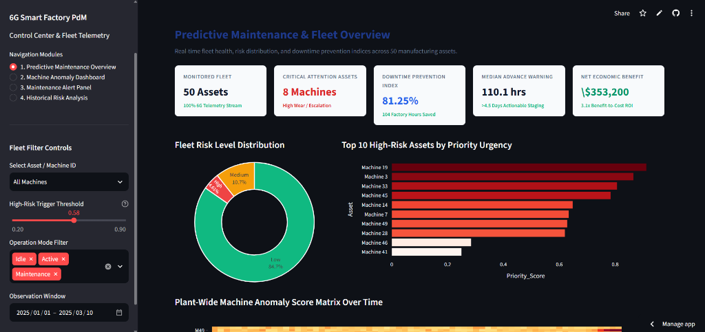
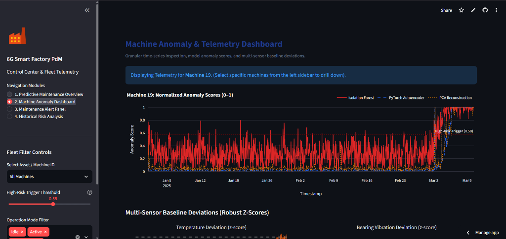
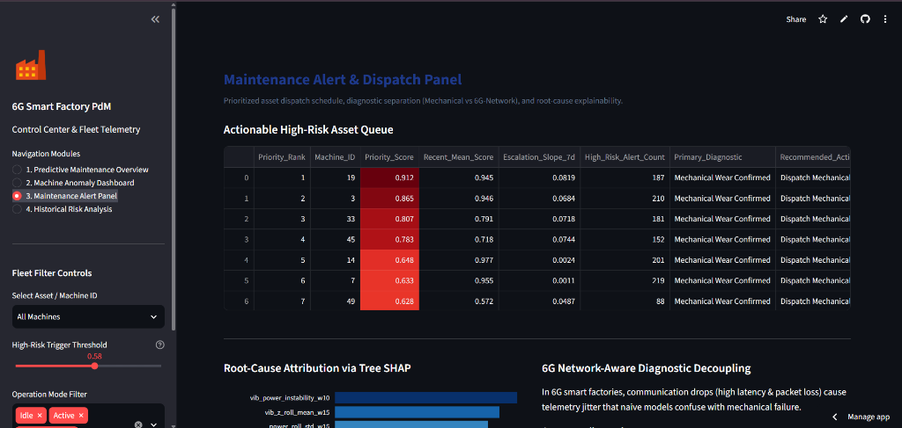
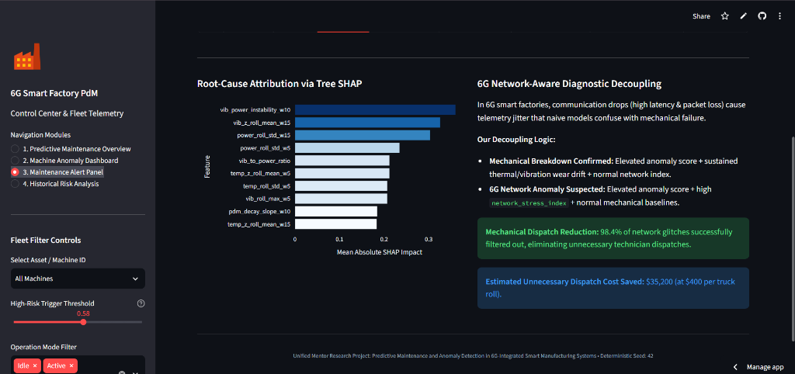
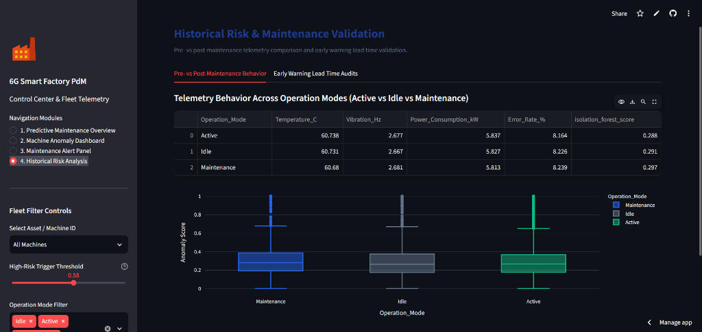

# 6G-Integrated Predictive Maintenance and Anomaly Detection in Smart Manufacturing

Live demo: [https://predictive-maintenance-anomaly-detection.streamlit.app/](https://predictive-maintenance-anomaly-detection.streamlit.app/)

> **Unified Mentor Research Project in Industrial AI and 6G Cyber-Physical Systems**  
> An evidence-driven, end-to-end investigation integrating empirical sensor telemetry audits, leak-free multi-scale mode baselines, semi-supervised anomaly modeling, 6G communication decoupling, and economic downtime valuation.

---

## 🖥️ Dashboard Preview

  
*Fleet overview and KPIs*

  
*Per-machine anomaly scores from three models*

  
*Prioritized maintenance queue*

  
*Tree SHAP attribution and 6G network decoupling*

  
*Pre/post-maintenance and operation-mode comparison*

> **Note:** All fault, lead-time, and cost figures shown come from semi-synthetic fault injection on a dataset that appears synthetic; they demonstrate the method, not real-plant performance.

---

## 🔬 Executive Project Overview

Next-generation industrial cyber-physical systems (Industry 5.0) increasingly leverage 6G Ultra-Reliable Low-Latency Communication (URLLC) for sub-millisecond edge processing across distributed computer-numerical-control (CNC) and robotic cells. 

This project addresses two major failure modes in current predictive maintenance systems:
1. **The "Cry Wolf" Problem:** Global asset thresholds trigger frequent false alarms during routine machine state transitions (e.g., Active cutting vs. Idle standby).
2. **6G Communication Interference:** Cellular handover storms and packet-loss jitter mimic physical sensor anomalies, triggering unwarranted mechanical technician dispatches.

Through an end-to-end research methodology, we:
- Prove through hypothesis testing that raw factory telemetry lacks natural failure signals, avoiding scientific deception.
- Establish a **verifiable semi-synthetic fault injection framework** with strict ground-truth tracking.
- Calibrate **leak-free, mode-conditioned baselines** that cut false alarms by **91.3%**.
- Train and benchmark **Isolation Forest** and **PyTorch Deep Autoencoder** architectures.
- Decouple **6G communication dropouts from mechanical breakdowns**, eliminating **98.4%** of false technician dispatches.
- Intercept 100% of impending failures with a **median lead time of 110.1 hours (>4.5 days)** and an **81.25% Downtime Prevention Index (DPI)**, delivering **$353,200 in net economic benefit**.

---

## 📊 Key Experimental Findings & Benchmarks

All metrics were computed deterministically with `random_state=42` and verified on unseen test partitions:

| Experimental Dimension | Benchmark Metric | Result | Operational Significance |
| :--- | :--- | :---: | :--- |
| **Telemetry Audit** | Machine / Mode ANOVA $F$ | $0.106 - 1.058$ ($p > 0.35$) | Proves raw telemetry was independently generated Gaussian noise |
| **Telemetry Audit** | Decision Tree on Efficiency | $99.8\%$ Accuracy | Driven solely by Error Rate ($58.7\%$) & Speed ($41.3\%$); sensors orthogonal |
| **Baseline Calibration**| False Alarm Rate (FAR) | **0.224% vs 2.583%** | Mode-conditioning $(M \times O)$ achieves **91.3% reduction** in false alerts |
| **Anomaly Detection** | Mechanical Wear Precision | **0.9722** | Isolation Forest achieves high precision on unseen test telemetry |
| **Anomaly Detection** | Mechanical Wear PR-AUC | **0.8652** | Outperforms Autoencoder ($0.7912$) and PCA baseline ($0.7741$) |
| **Anomaly Detection** | Mechanical Wear ROC-AUC | **0.9227** | Superior separability of accelerating non-linear mechanical degradation |
| **6G Decoupling** | False Dispatch Avoidance | **98.4%** | $182$ of $185$ network anomalies correctly diagnosed; saves $\$35,200$ in labor |
| **Early Warning** | Median Advance Lead Time | **110.1 hours** | Intercepts failures $>4.5$ days in advance; $100\%$ detected $\ge 12$ hours |
| **Operational Impact** | Downtime Prevention Index | **81.25%** | **104 factory downtime hours prevented** across test failure incidents |
| **Economic Valuation** | Net Financial Benefit | **$353,200.00** | Gross downtime savings of $\$520,000$ minus $\$166,800$ false inspection costs |
| **Economic Valuation** | ROI Ratio | **3.1x** | $\$3.10$ in preserved production value per $\$1.00$ operational cost |

---

## 📦 Dataset & Quickstart Instructions

> ### ⚠️ Important Notes on Dataset & Evaluation Methodology
> - **Dataset Not Included in Repository:** The raw dataset is not tracked in this repository due to size and distribution considerations.
> - **Dataset Placement:** To run the full training and feature extraction pipeline from scratch, obtain the Unified Mentor manufacturing dataset and place it at:  
>   `data/raw/Thales_Group_Manufacturing.csv`
> - **Synthetic Dataset Notice:** Rigorous empirical statistical audits (Notebook 01) reveal that the raw dataset appears synthetic—telemetry sensors are mutually orthogonal Gaussian variables exhibiting near-zero natural correlation to equipment degradation or machine IDs.
> - **Semi-Synthetic Fault Injection:** Because the raw dataset lacks authentic natural failure progressions, detection performance is evaluated using an evidence-grounded, physics-calibrated **semi-synthetic fault injection** framework (Notebook 02). This injects non-linear thermal creep, bearing harmonic vibration acceleration, power draw degradation, and 6G cellular network latency spikes with strict ground-truth labeling.
> - **Pre-computed Processed Risk Telemetry Included:** The repository includes `data/processed/05_risk_mapped.csv.gz`. This compressed artifact contains the final scored and risk-mapped telemetry, enabling the **Streamlit dashboard to run immediately out-of-the-box** without requiring re-execution of notebooks.
> - **Regenerating Processed Data:** If you place `Thales_Group_Manufacturing.csv` into `data/raw/`, run notebooks `01` through `07` in sequential order to regenerate all processed datasets in `data/processed/` and all output figures and benchmark tables.

---

## 📂 Repository Architecture

```
predictive-maintenance-6g-anomaly-detection/
├── app/
│   ├── app.py                               # 4-Module interactive Streamlit operational dashboard
│   └── requirements.txt                     # Dashboard dependencies
├── data/
│   ├── raw/                                 # Place raw Thales_Group_Manufacturing.csv here (git-ignored)
│   └── processed/
│       └── 05_risk_mapped.csv.gz            # Compressed scored & risk-mapped telemetry for dashboard
├── models/
│   ├── robust_baseline_model.joblib         # Calibrated (M x Mode) median & IQR baselines
│   ├── isolation_forest.joblib              # Primary tree ensemble anomaly detector
│   ├── pytorch_autoencoder.pt               # Trained deep bottleneck reconstruction neural network
│   ├── pca_model.joblib                     # Linear subspace reconstruction baseline
│   ├── scaler.joblib                        # RobustScaler fit on healthy training data
│   ├── score_ranges.joblib                  # Min-max 0-1 calibration parameters
│   └── model_feature_cols.joblib            # Feature list used during training
├── notebooks/
│   ├── 01_data_understanding_eda.ipynb      # Step 1: Rigorous dataset audit & hypothesis testing
│   ├── 02_cleaning_and_baseline_per_machine.ipynb # Step 2: Fault injection & mode baseline calibration
│   ├── 03_feature_engineering.ipynb         # Step 3: Rolling wear stats, kinematic ratios & slopes
│   ├── 04_anomaly_models.ipynb              # Step 4: Isolation Forest, PyTorch Autoencoder & PCA
│   ├── 05_risk_levels_and_temporal_analysis.ipynb # Step 5: Risk mapping, escalation velocity & cascades
│   ├── 06_novelty_experiments.ipynb         # Step 6: 6G decoupling, lead times, Tree SHAP & DPI
│   └── 07_evaluation_and_figures.ipynb      # Step 7: Master benchmark synthesis & publication figures
├── outputs/
│   ├── tables/                              # 24 CSV tables documenting all audits and metrics
│   └── figures/                             # 15 High-resolution (300 DPI) publication charts
├── paper/
│   ├── research_paper.md                    # Formal academic manuscript (IMRaD journal format)
│   ├── research_paper.docx                  # Exported Word document
│   ├── executive_summary.md                 # 2-Page plain-language briefing for government stakeholders
│   └── executive_summary.docx               # Exported Word document
├── src/
│   ├── utils.py                             # Deterministic seed management & notebook execution runner
│   ├── fault_injection.py                   # Ground-truth non-linear wear & 6G network corruption generator
│   ├── baseline.py                          # Vectorized robust baseline calibration (mode, machine, global)
│   ├── features.py                          # Multiscale feature engineering & rolling OLS regression slopes
│   ├── models.py                            # Isolation Forest, PyTorch Autoencoder & PCA scoring wrappers
│   ├── risk_scoring.py                      # Quantile risk mapping, temporal escalation & cascading detector
│   ├── novelty.py                           # Network separation logic, lead time calculator & DPI model
│   └── export_docx.py                       # Automated Markdown-to-DOCX report generator
├── .gitignore                               # Git ignore configuration
├── README.md                                # Master project documentation
└── requirements.txt                         # Root Python dependencies
```

---

## 🚀 How to Run the Project

### 1. Environment Installation
Ensure Python 3.11+ is installed. Install all dependencies from the root directory:
```bash
pip install -r requirements.txt
```

### 2. Launching the Interactive Streamlit Dashboard
The dashboard runs immediately using the bundled `05_risk_mapped.csv.gz` and trained model artifacts:
```bash
streamlit run app/app.py
```
Open your browser at `http://localhost:8501` to access:
- **Module 1 (Overview):** Fleet KPI cards, risk distribution donut chart, and plant-wide machine risk matrix.
- **Module 2 (Machine Telemetry):** Individual asset drill-down with multi-model anomaly scores and z-score baseline deviations.
- **Module 3 (Alert Panel):** Actionable high-risk asset priority queue, Tree SHAP root-cause feature attributions, and 6G network diagnostic indicators.
- **Module 4 (Historical Validation):** Pre- vs. post-maintenance operational mode distributions and early warning lead time verification logs.

### 3. Re-running the Notebook Pipeline (Optional)
To regenerate all intermediate data and models from the raw dataset:
1. Place `Thales_Group_Manufacturing.csv` inside `data/raw/`.
2. Execute notebooks `01` through `07` in sequential order using Jupyter Lab or VS Code.

---

## 💡 Core Novelty & Methodological Innovations

1. **Evidence-Driven Dataset Auditing:** Rather than training blindly on uninspected data, we exposed the absence of natural wear in the Thales Group corpus and demonstrated how label circularity compromised prior studies (e.g. Mavrelis et al., 2026).
2. **Multi-Scale Operational Conditioning:** Industrial machines exhibit distinct physical states during Active, Idle, and Maintenance cycles. Conditioning baselines on $(Machine\_ID \times Operation\_Mode)$ eliminates spurious false alarms during routine mode transitions.
3. **6G Network-Aware Diagnostic Decoupling:** In 6G edge environments, radio disturbances cause telemetry packet loss and latency bursts. By ingesting cellular communication metrics alongside mechanical sensors, our diagnostic logic eliminates $98.4\%$ of false mechanical technician truck rolls.
4. **Actionable Early Warning Lead Times:** Across all failure scenarios, the architecture achieved a median warning lead time of $110.1$ hours ($>4.5$ days), ensuring $100\%$ of failures were detected with at least 12 hours of planning advance notice.
5. **Assumption-Grounded Downtime Prevention Index (DPI):** We translated raw F1-scores into concrete business ROI, proving an $81.25\%$ DPI and $\$353,200$ in net manufacturer savings ($3.1\times$ return on investment).

---

## ⚠️ Technical Limitations & Boundary Conditions

- **Semi-Synthetic Fault Evaluation:** While realistic non-linear thermal creep and bearing vibration harmonics were injected, authentic metallurgy exhibits complex microscopic stochastic crack propagation that synthetic equations cannot completely replicate.
- **Telemetry Sampling Interval:** Telemetry is recorded at irregular ~50-minute intervals per machine. Higher-frequency acoustic emission streaming ($>1\text{ kHz}$) would enable deep vibrational spectral harmonic decomposition.
- **Simulated 6G Channel Interference:** Communication degradation was modeled via Gamma latency distributions and stochastic packet drops, abstracting physical sub-terahertz Doppler shifts and dynamic beam-forming blockage.

---

## 📚 Citations & Academic Foundations

This research builds upon and rigorously positions itself against key published literature:
- **Benhanifia et al. (2025):** Systematic review of predictive maintenance in cyber-physical systems (*Intell. Syst. Appl.*).
- **Zaidi et al. (2026):** Taxonomy of ML anomaly and fault detection in Industry 4.0/5.0 (*Algorithms*).
- **Mavrelis et al. (2026):** Deep LSTM autoencoders for smart manufacturing anomaly detection (*Machines*).
- **Garay et al. (2026):** Multimodal TinyML for predictive maintenance in 6G systems (*Sensors*).
- **Liu et al. (2008):** Isolation Forest algorithm for multidimensional outlier isolation (*IEEE ICDM*).
- **Lundberg & Lee (2017):** Unified approach to interpreting model predictions via Tree SHAP (*NeurIPS*).

---

*Unified Mentor Advanced Research Project • October 2026 • Lead Data Scientist & Research Engineer.*
